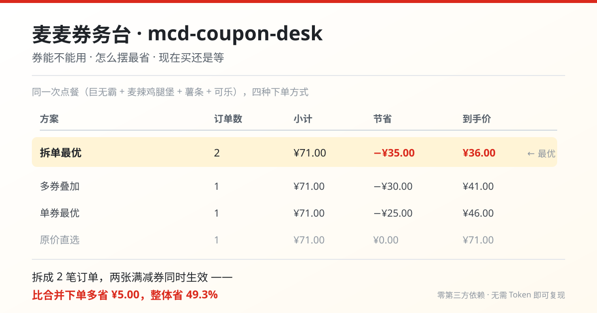

# mcd-coupon-desk

[](LICENSE)
[](https://mcp.mcd.cn)
[](https://www.python.org/)
[](#quick-start--no-token-required)
[](#run-the-tests)
[](https://github.com/zjh-1024/mcd-coupon-desk/actions/workflows/ci.yml)

**Turn the money side of ordering at McDonald's into a deterministic calculation.**

> Can these coupons be used? / How do I arrange items for the lowest price? / Buy now, or wait?

| Coupon eligibility | Exact top-up | Split-order savings | No token needed |
|:---:|:---:|:---:|:---:|
| Five reasons a coupon is blocked, plus the shortfall | 0/1 knapsack DP, exact | Sample saves CNY 35.00 (49.3%) | Runs offline |



> 中文说明见 [README.md](README.md)。

McDonald's discounts are scattered across the store menu, the account coupon wallet,
store-specific coupons and the campaign calendar. What users actually get stuck on is not
'do I have any coupons', but three concrete questions:

1. **Which of my coupons work today, at this store?** - and why are the others blocked?
2. **If they work, how should I arrange the order?** - one coupon per order, or split into two orders each using one?
3. **Is now the cheapest time to buy?** - or is it worth waiting a couple of days for a campaign?

This project answers all three with **deterministic algorithms**, so results are reproducible and auditable.

**No guessing**: every cent can be recomputed - which coupon works and why, the minimum top-up
needed to reach a threshold, and how much extra a split order saves.

> This work is an entry to the McDonald's Developer Innovation Challenge and is not an official
> McDonald's product. Menu items, prices and discount rules are subject to the official
> McDonald's channels in real time.

---

## Quick start - no token required

```bash
git clone https://github.com/zjh-1024/mcd-coupon-desk.git
cd mcd-coupon-desk
python mcd-coupon-desk.py demo
```

Python 3.10+ standard library only - **no pip install, no API key**.
`demo` reads the sample store data in `examples/sample_catalog.json` and runs the full pipeline.

### Real run output

```console
$ python mcd-coupon-desk.py demo

Conclusion
----------------------------------------------------------
Split-order is best: pay CNY 36.00, saving CNY 35.00 (49.3%) vs list price.

Plan comparison
----------------------------------------------------------
Plan          Orders      Subtotal      Saving       Total
Split-best         2        CNY 71.00   CNY 35.00    CNY 36.00   <- best
Stacked            1        CNY 71.00   CNY 30.00    CNY 41.00
Single-best        1        CNY 71.00   CNY 25.00    CNY 46.00
List price         1        CNY 71.00    CNY 0.00    CNY 71.00
```

(The demo prints in Chinese; the numbers above are the actual sample-data output and do not
represent any real price.)

---

## How it works

The project deliberately keeps **numbers away from the LLM**. The model understands
'add a Big Mac and fries'; the numbers and constraints live in deterministic code, so every
amount can be recomputed.

### 1. Coupon eligibility: five concrete reasons a coupon is blocked

`src/mcd_coupon_desk/coupons.py`

Reasons are ordered by 'what the user cannot change' first - validity and store scope are fixed,
whereas thresholds and item matching can be satisfied by adding items.

| Reason code | Meaning | What the user can do |
|---|---|---|
| `NOT_STARTED` | Not yet active | Wait |
| `EXPIRED` | Expired | - |
| `WRONG_STORE` | Not valid at this store | Switch store |
| `THRESHOLD_NOT_MET` | Below threshold (**shortfall is reported**) | Add items worth the gap |
| `ITEM_MISMATCH` | No applicable item in cart | Add a matching category |

### 2. Exact top-up, not a greedy approximation

`solver.minimal_subset_reaching()`

To use a spend threshold coupon, 'what is the cheapest set to add?' is a
**minimum subset sum >= threshold** problem, solved exactly with one 0/1 knapsack DP pass.

### 3. Why a split order can save more than one combined order

Coupon thresholds are judged **per order**, and a coupon can be used only once per order.
Splitting the cart into two orders lets two spend-threshold coupons both take effect.
Allocating items to coupons is a set-partition problem (exponential); rather than full
enumeration, the solver runs three orderings and keeps the best:

| Ordering | Intuition |
|---|---|
| Discount amount descending | Grab the big coupon first |
| Discount rate (discount / threshold) descending | Leave room for smaller coupons |
| Threshold ascending | Satisfy easy coupons first |

### 4. Stacking: under-count rather than over-claim

A coupon's `group` field marks mutually exclusive groups. Coupons without a group are treated
as mutually exclusive by default, because overstating savings is worse than understating it.
Use `--assume-stackable` to relax.

### 5. Money is integer cents throughout

All amounts are stored and computed as integer cents. Floating point in pricing produces
0.1 + 0.2 style errors that are enough to pick the wrong optimum.

---

## Using the McDonald's MCP

Request a token: https://open.mcd.cn/mcp -> phone login -> console -> activate -> copy.

```bash
export MCD_MCP_TOKEN="your-token"       # never write it into any file

python mcd-coupon-desk.py --store 1410419 menu
python mcd-coupon-desk.py --store 1410419 diagnose --want "Big Mac,fries,cola"
python mcd-coupon-desk.py --store 1410419 plan --want "Big Mac,fries,cola"
python mcd-coupon-desk.py tools         # print the real tool list and input schema
```

See [MCP_INTEGRATION.md](MCP_INTEGRATION.md) for the tools used and the call flow.

---

## Who it is for

- **Students / commuters** on a fixed budget who want the best deal without re-comparing every menu item.
- **Coupon hoarders** who have a dozen coupons but cannot tell which expire today.
- **Group-order initiators** deciding between one order and two.
- **People balancing nutrition and cost** - this project handles the cost side.

---

## Project layout

```
mcd-coupon-desk/
|-- mcd-coupon-desk.py          zero-install launcher
|-- src/mcd_coupon_desk/
|   |-- models.py               domain models (money = integer cents)
|   |-- coupons.py              coupon eligibility
|   |-- solver.py               four plans (incl. exact top-up DP)
|   |-- catalog.py              data-source adapters (offline sample / MCP)
|   |-- textparse.py            parse MCP 'prose + embedded JSON' responses
|   |-- mcp_client.py           zero-dependency Streamable HTTP MCP client
|   |-- report.py               output rendering
|   |-- cli.py                  command-line entry point
|-- tests/                      49 unit tests
|-- assets/                     demo result image
|-- examples/sample_catalog.json
```

---

## Run the tests

```bash
python -m unittest discover -s tests -v
```

**49 tests**, covering lossless cent conversion, exactness of top-up, the five block reasons,
correctness of the four plans, the 'ungrouped = exclusive' conservative assumption, parsing of
MCP response text, and fixed-price coupon savings. CI runs them on Python 3.10-3.13.

---

## Security and compliance

- **No real tokens, secrets or credentials** are stored in this repository; `mcp-config.example.json` only uses the `${MCD_MCP_TOKEN}` placeholder.
- **Write operations** (claiming coupons, placing orders) always require explicit user confirmation; nothing runs silently.
- The project **only reads official API data** and computes locally - it does not forward, upload or cache user data to any server.
- Amounts are local estimates; the final price is subject to the official `calculate-price` and checkout page.

---

## License

MIT - see [LICENSE](LICENSE).
